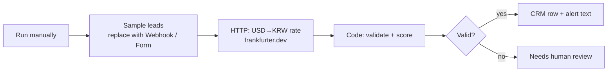

# n8n workflow sample · n8n 업무 자동화 샘플

**Lead intake → validate → currency conversion → routing**, importable into n8n (tested on n8n 2.35).



- Workflow: [`workflows/lead-intake.json`](workflows/lead-intake.json) (generated by `build_workflow.py`)
- Real run output from `n8n execute`: [`docs/execution-output.json`](docs/execution-output.json) — 2 qualified leads, 2 sent to review (invalid email; missing name + budget)
- In a client project the sample node becomes a Webhook / Form / Google Sheets trigger and the last nodes write to the CRM, Slack, Telegram or email with the client's own credentials.

```bash
n8n import:workflow --input=workflows/lead-intake.json
n8n execute --id=maniLeadIntake01
```

한국어: 문의(리드)를 받아 이메일·이름·예산을 검사하고, 환율 API로 원화 금액을 붙인 뒤 등급을 매겨 정상 건은 CRM·알림용으로, 문제 건은 사람 확인용으로 나눕니다. n8n에서 실제 실행한 결과를 함께 올렸습니다.

---
**About / 안내** — Sample by **MANI** (Korea). Built with AI-assisted development (Claude Code) and run/tested before publishing. Custom work available on Kmong and Fiverr.
MANI 샘플입니다. AI 보조 개발(Claude Code)로 만들고 공개 전에 직접 실행·테스트했습니다. 맞춤 작업은 크몽·Fiverr에서 주문할 수 있습니다.
